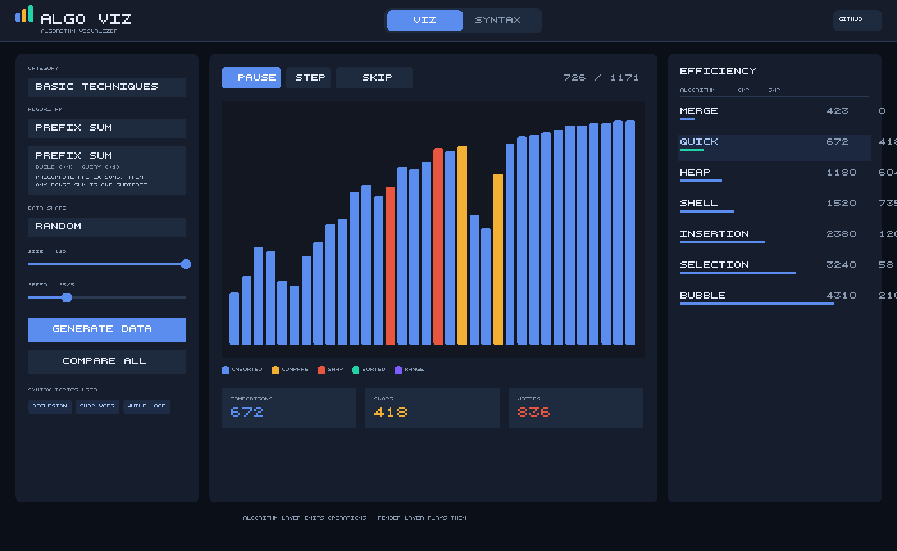
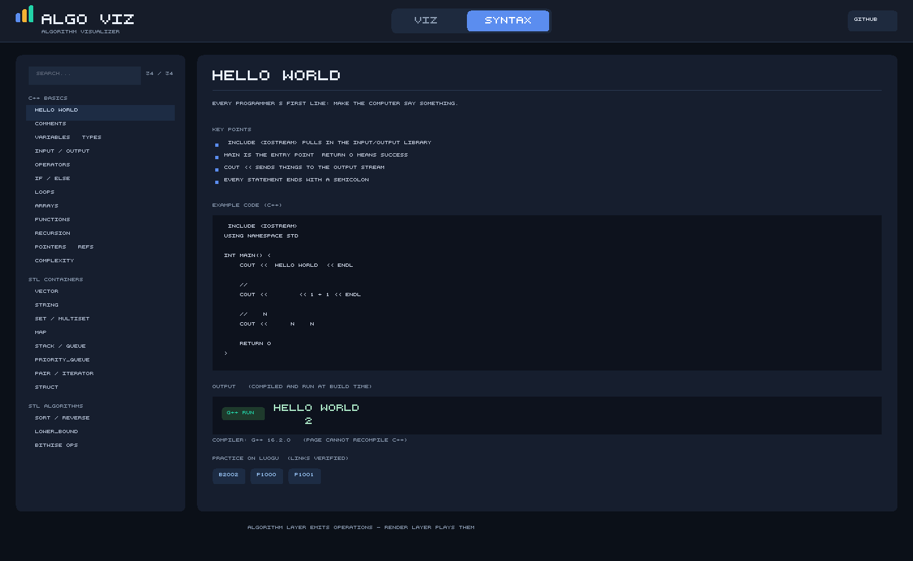

# 算法可视化 · Algo Viz

把算法执行过程变成**看得见的动画**，并配套一套**能真跑的 JS 语法基础教程**（从 Hello World 开始）。

纯静态站点，**零依赖、零构建步骤**，克隆下来双击就能跑，推上 GitHub Pages 就能分享给任何人。

**在线体验：** https://huy0011.github.io/algorithm/

---

## 两个页签，两条学习路径

| 页签 | 内容 | 适合谁 |
|---|---|---|
| **算法可视化** | **23 个**算法 / 数据结构，8 个分类，每类有专属渲染方式 | 想看「算法到底怎么跑的」 |
| **C++ 语法 / STL** | **34 个** C++ 知识点，示例经 g++ 真实编译；每个都配 2-5 道洛谷真题 | 从零开始学 C++，或看不懂算法代码 |

两者是**互相跳转**的：每个算法旁边列出它用到的语法点，点一下跳到讲解；
每个语法点底部列出用它的算法，点一下跳回动画。**看不懂哪行代码，就去点它。**

另外每个知识点和算法都配了**洛谷练习入口**（搜索链接 + 官方题单）。

### 算法可视化



### C++ 语法 / STL



> 注：以上两张图是在 Node 里合成的示意图（本机沙箱禁止命名管道，Chrome 起不来无法截图）。
> 因为是自绘点阵字体，示意图里的文字用了英文标签；**真实页面上是中文**。

---

## 这个项目解决什么问题

看伪代码学排序，你看到的是 `for i = 0 to n-1`；看动画学排序，你看到的是**数据在动**。后者更容易建立直觉。

但光有动画还不够 —— 很多人卡在「看懂了动画，读不懂代码」。所以补了第二块：**把算法用到的语法点单独讲清楚，并且每段代码都能点一下就真跑给你看结果**。

再进一步：语法教程本身从**完全零基础**开始（什么是程序 → Hello World → 变量 → 输入输出 → …），
让没写过代码的人也能从这里起步。

同时，它也是一次完整的工程实践：算法逻辑与渲染逻辑**彻底解耦**，新增算法不需要改动任何一行渲染代码。

---

## 快速开始

因为用了 ES Modules，浏览器的 `file://` 协议会拦截模块加载，所以需要一个本地服务器：

```bash
# 方式一：用仓库自带的零依赖服务器
node tests/serve.js          # 等价于 npm start
# 然后打开 http://localhost:5173

# 方式二：用 Python
python -m http.server 5173

# 方式三：VS Code 的 Live Server 插件，右键 index.html
```

> 需要 Node.js 18+（只用内置模块，**不需要 `npm install`**）。

### 运行测试

```bash
npm test              # 三个套件全跑
npm run test:algo       # 算法正确性（约 880 次运行）
npm run test:technique  # 基础技巧/字符串/位运算（与暴力实现对拍）
npm run test:renderers  # 渲染器健壮性
npm run test:classes    # 类的重复方法名（静默覆盖检查）
npm run test:syntax   # 语法教程示例可执行性
npm run test:ui       # 界面集成测试
npm run screenshot    # 重新生成两张示意图
```

---

### C++ 示例的构建流程

C++ 示例的输出是**构建期**编译得到的（浏览器跑不了 C++）。要重新生成：

```bash
node tests/build-cpp.js            # 阶段一：写出 .cpp 源文件
# 然后编译运行（本机沙箱禁止 Node 直接 spawn 子进程，所以要单独跑这步）
# 见 tests/build-cpp.ps1 里的循环，或手动用 g++ 编译 .cpp-build/*.cpp
node tests/build-cpp.js --collect  # 阶段三：收集真实输出成 cpp-output.js
```

编译产物写在 `.cpp-build/`（**不入库**），只有收集结果 `src/syntax/cpp-output.js` 入库。

> 这里分三步是环境所迫：本机沙箱禁止 Node 的 `child_process` 以 piped stdio
> 启动子进程（实测得到 `spawnSync g++ EPERM`），而 PowerShell 直接调用 g++ 是可行的。
## 全部 23 个算法 / 数据结构

### 比较排序（7 个）

| 算法 | 时间复杂度 | 空间 | 稳定性 | 特点 |
|---|---|---|---|---|
| 冒泡排序 | O(n²) | O(1) | 稳定 | 相邻比较，带「本轮无交换则提前结束」优化 |
| 选择排序 | O(n²) | O(1) | 不稳定 | 交换次数最少（最多 n-1 次） |
| 插入排序 | O(n²) | O(1) | 稳定 | 接近有序时极快 |
| 希尔排序 | O(n^1.3) ~ O(n²) | O(1) | 不稳定 | Knuth 增量序列（1, 4, 13, 40…） |
| 归并排序 | O(n log n) | O(n) | 稳定 | 分治；用「写入」而非「交换」计量 |
| 快速排序 | O(n log n) 平均 | O(log n) | 不稳定 | Lomuto 分区，显式栈避免爆栈 |
| 堆排序 | O(n log n) | O(1) | 不稳定 | 建大顶堆 + 反复取堆顶 |

### 非比较排序（3 个）

| 算法 | 时间复杂度 | 空间 | 看点 |
|---|---|---|---|
| 计数排序 | O(n + k) | O(k) | **比较次数恒为 0** —— 它根本不比较 |
| 基数排序 | O(d × (n + k)) | O(n + k) | 按个位 → 十位 → 百位，逐位分配收集 |
| 桶排序 | O(n + k) 平均 | O(n + k) | 分布均匀时极快，全挤一个桶就退化 |

> 这一类的教学价值在于打破一个直觉：**排序不一定非要两两比较**。
> 动画上你会看到「没有任何柱子互相比较」的排序过程。

### 查找 / 二分（2 个）

| 算法 | 时间复杂度 | 看点 |
|---|---|---|
| 二分查找 | O(log n) | 候选区间每次折半；n 翻倍，步数只加 1 |
| 二分答案 | O(n log C) | 不搜数组而是搜「答案的取值范围」，前提是判定函数单调 |

### 路径查找（2 个）

| 算法 | 时间复杂度 | 看点 |
|---|---|---|
| 广度优先 BFS | O(V + E) | 用队列，一圈圈规则扩散，**找到的必然是最短路径** |
| 深度优先 DFS | O(V + E) | 用栈，一条道窜到底，**路径通常不是最短** |

> 这两个的动画形状差异一眼可见，是「队列 vs 栈」最好的教学演示。
> 测试里实测过：60 组随机地图中 DFS 有约 22 组的路径不是最短 —— 这是它的固有特性，不是 bug。

### 数据结构（2 个）

| 结构 | 特性 | 演示场景 |
|---|---|---|
| 栈 | 后进先出 LIFO | 括号匹配 |
| 队列 | 先进先出 FIFO | 任务调度 |

### 基础技巧（4 个）— 竞赛高频

| 算法 | 时间复杂度 | 看点 |
|---|---|---|
| 双指针 · 两数之和 | O(n) | 和偏小就右移左指针，偏大就左移右指针；每次移动排除一整列组合 |
| 滑动窗口 | O(n) | 右指针扩张、左指针收缩，求「最长/最短的满足条件的连续区间」 |
| 前缀和 | O(n) 预处理 / O(1) 查询 | 预先累加，之后区间和只需一次减法 |
| 差分数组 | O(1) 修改 / O(n) 还原 | 区间批量加值只在两端各标记一次；前缀和的逆运算 |

### 字符串（2 个）

| 算法 | 时间复杂度 | 看点 |
|---|---|---|
| KMP | O(n + m) | 先看 next 数组怎么构建，再看「失配时主串指针 i 永不回退」 |
| 字符串哈希 Rabin-Karp | O(n + m) 平均 | 滑动窗口配合前缀哈希，哈希不同直接跳过，省掉逐字符比较 |

### 位运算（1 个）

| 算法 | 时间复杂度 | 看点 |
|---|---|---|
| 位运算 | O(1) | 把整数拆成二进制位，逐位展示与/或/异或，以及移位等于乘除 2 |

### C++ 语法 / STL（34 个知识点，4 组）

| 分组 | 知识点 |
|---|---|
| **C++ 基础（12 个）** | **Hello World**、注释、变量与基本类型、输入与输出、运算符、条件分支、循环、数组、函数、递归、指针与引用、复杂度入门 |
| **STL 容器（8 个）** | `vector`（动态数组）、`string`、`set` / `multiset`（有序集合）、`map`（键值对）、`stack` / `queue`（栈与队列）、`priority_queue`（优先队列 / 堆）、`pair` 与迭代器、`struct`（自定义类型） |
| **STL 算法（3 个）** | `sort` / `reverse` / `unique`、`lower_bound` / `upper_bound`（二分查找）、位运算 |

**每个示例都是完整的、可以直接编译的 C++ 程序**（含 `#include` 与 `main`），
页面上展示的输出是**构建期用 g++ 真实编译运行得到的**，不是手写的。

> **重要说明：为什么输出是「预先录制」的？**
>
> 浏览器**无法执行 C++**，而本项目部署在 GitHub Pages（纯静态托管，没有后端）。
> 所以 C++ 示例不可能像普通网页 demo 那样「点一下就重新编译运行」。
>
> 本项目采用的做法是：构建期把 57 个示例用 `g++ -std=c++17 -O2` **全部编译并运行一遍**，
> 把真实 stdout 录进 `src/syntax/cpp-output.js`，页面读取展示。
>
> - ✅ 你看到的输出是**真实编译运行的结果**，不是我手写的
> - ✅ 页面上明确标注了编译器版本，以及「本页不能重新编译」
> - ❌ 你不能在网页上改代码重跑（想试可以复制到本地或在线编译器）
>
> 这是当前架构下最诚实的做法：**不假装能跑，但保证展示的确实跑过**。

---

## 洛谷真题与题单

每个知识点和每个算法都配了 **2-5 道精选真题**，带题号、标题与直达链接：

| 知识点 | 精选真题 |
|---|---|
| Hello World | B2002 Hello,World! · P1000 超级玛丽游戏 · P1001 A+B Problem |
| 分支结构 | P5710 数的性质 · P5711 闰年判断 · P5712 Apples |
| 循环结构 | P5718 找最小值 · P5719 分类平均 · P5720 一尺之棰 |
| 数组 | P1428 小鱼比可爱 · P1427 小鱼的数字游戏 · P5727 冰雹猜想 |
| 排序 | P1177【模板】排序 · P1271 选举学生会 · P1059 明明的随机数 |
| 二分查找 | P2249【深基13.例1】查找 · P1102 A-B 数对 · P1678 烦恼的高考志愿 |

合计 **128 道题**，全部带链接。

### 这些题目的来源

题目**抓取自洛谷官方题单**，不是我凭记忆写的：

- 【入门1】顺序结构 https://www.luogu.com.cn/training/100
- 【入门2】分支结构 https://www.luogu.com.cn/training/101
- 【入门3】循环结构 https://www.luogu.com.cn/training/102
- 【入门4】数组 https://www.luogu.com.cn/training/103
- 【入门5】字符串 https://www.luogu.com.cn/training/104
- 【入门6】函数与结构体 https://www.luogu.com.cn/training/105
- 【算法1-2】排序 https://www.luogu.com.cn/training/107
- 【算法1-6】二分查找与二分答案 https://www.luogu.com.cn/training/111

这些题单的官方描述明确写着「**以上题单的选题来自洛谷编写教材《深入浅出程序设计竞赛 - 基础篇》**」，
所以它们就是「深入浅出」的配套题单。

### 链接是核验过的

`tests/verify-problems-ui.js` 与 `tests/verify-problems-online.js` 两层校验：

1. **联网校验**：真的发 HTTP 请求，确认每个题号页面可访问、且页面标题以题号开头
2. **界面校验**：确认 34 个知识点 + 23 个算法在页面上都真的渲染出了题目链接

> 联网校验时踩过一个坑：洛谷会先返回 302 并要求带 cookie 重访同一地址，
> 直接让 fetch 自动跟随会陷入循环并报 `redirect count exceeded`。
> 需要手动跟随并携带 `C3VK` cookie。
## 核心设计：算法与渲染分离

这是整个项目最重要的设计决策，也是它能从「7 个排序」扩展到「23 个算法 + 8 个分类 / 6 种渲染器」而没有失控的原因。

### 唯一的契约：操作序列

算法**不认识 Canvas，不认识 DOM，不知道什么叫颜色**。它只做一件事：算完之后，交出「发生了什么」的流水账。

按可视化类型分四类动作：

```js
// 数组类（排序、非比较排序）
{ type: 'compare',        indices: [i, j] }
{ type: 'swap',           indices: [i, j] }
{ type: 'overwrite',      index: i, value: v }
{ type: 'markSorted',     index: i }
{ type: 'highlightRange', from, to, label }     // 本轮处理的区间/桶
{ type: 'markBucket',     bucketIndex, value, label }

// 查找类（二分查找、二分答案）
{ type: 'probe',  index, value, cmp }           // 探测某处，附带比较结果
{ type: 'narrow', lo, hi, reason }              // 收窄候选区间
{ type: 'found',  index, value }
{ type: 'answer', value, feasible, note }

// 网格类（BFS / DFS）
{ type: 'enqueue',   cell: [r, c] }
{ type: 'visit',     cell: [r, c] }
{ type: 'cameFrom',  cell, from }
{ type: 'path',      cell: [r, c] }

// 结构类（栈 / 队列）
{ type: 'push', value } / { type: 'pop', value } / { type: 'dequeue', value }
{ type: 'verdict', ok, note }
```

每个操作还附带一份 `stats` 快照，所以播放到任意位置，界面上的数字都是准的。

### 为什么这样设计

```
算法层 ──产出──▶ 操作序列 ──消费──▶ 渲染层
只关心「算什么」     纯数据        只关心「怎么画」
```

- **新增算法不用碰渲染代码**：写个函数，push 几种操作，注册到 `ALGORITHMS` 就完事。
- **可以任意跳转进度**：序列是自包含的，从第 0 步重放到第 k 步，画面与顺序播放完全一致。
- **可以对比任意算法**：对比功能只需对同一份数据多调几次 `run()`。
- **可以随时换渲染方式**：想从柱状图换成别的？新渲染层认识这些操作即可，算法层一行不改。

本次扩展就是这条原则的验证：**加了 9 个算法和 3 种全新渲染器（查找/网格/结构），排序算法和柱状图渲染器一行没改。**

### 覆盖（overwrite）为什么必须存在

只用「交换」描述所有排序是行不通的。归并排序的合并是**把值写到目标位置**，计数/基数/桶排序更是完全不做交换。用交换硬凑会让统计数字和动画语义都失真。

所以契约里有 `overwrite`。这说明契约是按**真实的算法行为**设计的，不是按某一种算法的方便程度设计的。

### 渲染层的组织

```
src/render/
├── base.js                 播放控制、尺寸自适应、绘制工具（所有渲染器共用）
├── bar-visualizer.js       柱状图（排序、非比较排序）
├── search-visualizer.js    区间条 + 指针（二分查找、二分答案）
├── grid-visualizer.js      网格（BFS、DFS）
├── structure-visualizer.js 栈/队列图形
└── factory.js              按算法类型创建渲染器 + 生成对应输入
```

每个渲染器只需实现两个方法：`_applyOp(op)` 和 `draw()`。
播放、跳转、统计、进度条、尺寸自适应都由 `BaseVisualizer` 提供。

### 添加一个新算法

在 `src/algorithms/` 下写函数，然后在 `ALGORITHMS` 里注册：

```js
import { BarTracer } from './tracer.js';

function mySort(input) {
  const t = new BarTracer(input);
  const n = t.array.length;

  for (let i = 0; i < n; i++) {
    for (let j = i + 1; j < n; j++) {
      if (t.greater(i, j)) t.swap(i, j);   // 自动记录比较与交换
    }
    t.markSorted(i);
  }
  return t.result();
}

export const ALGORITHMS = {
  // ...已有算法
  mysort: {
    id: 'mysort',
    name: '我的排序',
    en: 'My Sort',
    category: 'sort',                    // 决定用哪个渲染器
    complexity: { time: 'O(n²)', space: 'O(1)' },
    stable: false,
    blurb: '一句话说明它在干什么。',
    inputKind: 'array',                  // 决定需要什么样的输入数据
    run: mySort,
    syntaxTopics: ['nested-loop', 'variable-swap'],   // 关联语法点，id 必须已存在
  },
};
```

再把 id 加进 `ALGORITHM_ORDER` 即可。**渲染层、UI 层、测试代码都不需要改**（测试会自动把它纳入校验）。

---

## 目录结构

```
algo-viz/
├── index.html                   两个页签的骨架
├── package.json                 只有脚本，没有依赖
├── src/
│   ├── app.js                   入口层：串联 UI ↔ 算法 ↔ 渲染 ↔ 语法
│   ├── algorithms/
│   │   ├── tracer.js            契约定义：4 类操作 + 4 个 Tracer
│   │   ├── index.js             统一注册表（23 个算法 + 分类 + 语法关联）
│   │   ├── search.js            二分查找、二分答案
│   │   ├── path.js              BFS、DFS、地图生成
│   │   ├── noncompare.js        计数、基数、桶排序
│   │   └── structures.js        栈、队列
│   ├── render/
│   │   ├── base.js              公共播放基类
│   │   ├── bar-visualizer.js    柱状图渲染器
│   │   ├── search-visualizer.js 查找渲染器
│   │   ├── grid-visualizer.js   网格渲染器
│   │   ├── structure-visualizer.js 栈/队列渲染器
│   │   ├── factory.js           渲染器工厂 + 输入生成
│   │   └── player.js            requestAnimationFrame 播放器
│   └── syntax/
│       ├── cpp-topics.js        23 个 C++ 知识点（基础 + STL）
│       ├── cpp-detail-topics.js 11 个细化知识点（int/long long/float/double/溢出等）
│       ├── problems.js          128 道洛谷真题（联网核验）
│       ├── algorithms-cpp.js    （见 cpp-algos.js）
│       ├── cpp-algos.js         23 个算法的 C++ 实现
│       ├── cpp-output.js        构建期编译运行得到的真实输出
│       ├── content.js           装配层（知识点 + 输出 + 练习链接）
│       ├── algo-topics.js       算法 → C++ 知识点映射
│       └── runner.js            示例代码沙箱执行器
├── styles/
│   └── main.css                 全部样式
└── tests/
    ├── verify.js                   算法正确性（约 880 次运行）
    ├── verify-technique.js         基础技巧/字符串/位运算（与暴力实现对拍）
    ├── verify-cpp-content.js       C++ 教程内容（编译输出、关联、练习链接）
    ├── verify-renderers.js         渲染器健壮性（未 load 就 draw、空数据、尺寸为 0）
    ├── verify-styles.js            HTML/CSS 静态一致性（hidden 是否生效等）
    ├── verify-classes.js           类的重复方法名检查
    ├── verify-decoupling.js        解耦架构静态验证（算法层不碰 DOM、渲染层不认识算法名）
    ├── ui-integration.js           界面集成测试（DOM 桩跑真实 app.js）
    ├── build-cpp.js                C++ 编译验证：阶段一/三（写出源文件、收集结果）
    ├── build-cpp.ps1               C++ 编译验证：阶段二（调用 g++ 编译运行）
    ├── make-screenshot.js          合成 README 示意图
    └── serve.js                    零依赖本地服务器
```

四层职责清晰：**算法层**只产出序列，**渲染层**只播放序列，**入口层**翻译用户操作，**语法层**提供可执行的讲解。

---

## 测试

### 算法正确性（`tests/verify.js`，约 880 次运行）

不同可视化类型的「正确」含义不同，所以按家族分别校验：

- **排序 / 非比较排序**（10 个 × 43 用例）：不修改输入、结果有序、元素守恒、
  **重放操作序列结果一致**（渲染层任意跳转的前提）、下标不越界。
  另外额外校验非比较排序的**比较次数必须为 0**。
- **二分查找**（200 组随机用例）：命中时下标的值确实等于目标；未命中时目标确实不在数组里；
  探测次数不超过 `log₂(n)+1` 的理论上界。
- **二分答案**（120 组）：找到的解与**暴力求解**逐一对拍，必须完全一致。
- **寻路**（BFS/DFS 各 60 组随机地图）：路径连续（相邻格曼哈顿距离为 1）、首尾正确、不穿墙；
  **BFS 的路径长度必须等于独立实现算出的最短距离**。
- **栈 / 队列**：括号匹配的判定与独立实现交叉验证；队列校验先进先出。

### C++ 教程内容（`tests/verify-cpp-content.js`）

- **57 个 C++ 示例全部经 g++ 真实编译运行**（34 个知识点 + 23 个算法实现）
- 每个知识点都有完整代码（含 `#include` 与 `main`）、简介、要点、练习链接
- **编译输出非空**：不允许出现「标记成功但输出为空」的情况
- **内容确实是 C++**：检查没有残留 `console.log` / 箭头函数等 JS 写法
- 算法 ↔ C++ 知识点**双向关联 id 必须真实存在**（防止拼错导致跳转失效）
- 抽查输出正确性：Hello World 含 "Hello World"、KMP 的 next 数组为 `0 0 1 2 0`、
  9 个排序算法的输出都是正确的有序结果
- 洛谷链接：格式合法、中文关键词已编码、**没有写死题号**、题单面向「深入浅出」入门题单

### 界面集成（`tests/ui-integration.js`，40 项断言）

用最小 DOM / Canvas 桩，在 Node 里加载**真实的 `app.js`**，验证：

- 两个页签都能切换与渲染
- **23 个算法全部能加载、播放、重绘**
- **8 类渲染器**的播放控制（单步 / 跳转 / 重置）都正常
- 统计标签随可视化类型变化（网格没有「交换次数」）
- 对比表在排序与非比较排序两类下结果都正确
- **34 个 C++ 知识点全部可选中，并展示完整代码、编译输出与真题**
- 算法 ↔ 语法点双向跳转
- 洛谷练习入口链接格式合法、关键词已编码、没有写死题号

### 架构约束（`tests/verify-decoupling.js`）

项目最核心的承诺是「算法层只产出操作序列，渲染层只播放序列」。
但**这个承诺靠单元测试证明不了** —— 测试只能验证行为，无法阻止以后有人在算法里写一句
`document.querySelector`。所以这里做静态检查，把承诺变成可执行的约束：

- `src/algorithms/` 下不得出现任何 DOM / Canvas / 浏览器 API
- `src/render/` 下不得出现任何**具体算法名**（渲染层只该认识「操作类型」）
- 每个渲染器必须继承 `BaseVisualizer` 并实现 `_applyOp` 与 `draw`
- 分类用到的每种渲染器都必须在工厂里注册

> 检查时会先剥离注释——注释里说「不接触 DOM」是**解释**，不是耦合。
> 这个区分很关键：不剥离就会误报（写这个检查时我实际踩过一次，
> 把 `SpanTracer.window()` 这个「滑动窗口」方法误判成了浏览器 `window`）。

> 这套测试在开发中真的抓到了多个 bug，包括：
> 归并排序比较了正在被覆盖的数组；堆排序下沉终止条件写反；
> 空数组时标记越界下标；`StructureTracer` 里 `result()` 方法名冲突导致判定记录静默丢失；
> 字符串哈希用 32 位溢出「假装取模」导致漏匹配；
> 以及我自己写的 10 个指向不存在语法点的坏链接。

---

## 部署到 GitHub Pages

项目是纯静态的，**不需要构建步骤**，直接把仓库根目录作为站点发布即可。

```bash
# 1. 关联并推送（仓库已存在时）
git remote add origin https://github.com/huy0011/algorithm.git
git branch -M main
git push -u origin main
```

```
# 2. 打开仓库 Settings → Pages
#    Source:  Deploy from a branch
#    Branch:  main
#    Folder:  / (root)     ← 必须是 root，没有构建产物
#    → Save
```

等 1～2 分钟，访问 `https://huy0011.github.io/algorithm/`。

**部署注意事项：**

- **所有资源路径都必须是相对的**（`./src/app.js`）。本项目已全部使用相对路径，所以部署在子路径 `/<仓库名>/` 下也能正常工作。
- 因为用的是原生 ES Modules，**不需要打包工具**，也就不存在构建产物与源码不同步的问题。
- 推送后如果页面没更新，强制刷新（`Ctrl+F5`）绕过缓存。

---

## 快捷键

| 按键 | 功能 |
|---|---|
| `空格` | 播放 / 暂停 |
| `→` | 单步前进 |
| `Home` | 重置到第一步 |

（输入框和下拉框聚焦时快捷键不生效，避免干扰搜索。）

---

## 使用建议

想直观感受算法差异，试试这几组配置：

- **冒泡 vs 快排，规模拉到 120**：比较次数的差距最震撼（接近 10 倍）。
- **插入排序 + 「接近有序」**：几乎瞬间完成，这是它 O(n) 最好情况。
- **快速排序 + 「完全逆序」**：Lomuto 分区在逆序输入上会退化。
- **计数排序**：注意看统计区的「比较次数」始终是 0。
- **BFS vs DFS 用同一张地图跑**：扩散形状完全不同，BFS 是同心圆，DFS 是一条蛇。
- **归并排序**：注意它的动画形态和交换类算法完全不同 —— 它在做「写入」而不是「交换」。
- **差分数组**：注意它只在一个区间的**两端各戳一下**，最后一次性还原 —— 这就是 O(1) 修改的直观形态。
- **前缀和**：先看累加条怎么长起来，再看区间查询只需一次减法（对比朴素做法要累加很多次）。
- **KMP**：重点看失配那一刻 —— 主串指针 i **不动**，只有 j 按 next 回退。这就是它比暴力快的原因。
- **双指针**：每一步都能看出「排除了一整列组合」，所以从 O(n²) 变成 O(n)。
- **位运算**：切换与/或/异或，看逐位计算时高亮列怎么移动；顺便注意左移就是乘 2。

---

## 一个诚实的说明：关于统计口径

界面上的**交换次数**不是跨算法比较效率的公平指标，原因有三：

1. 插入排序和希尔排序用「相邻交换」实现，是为了产生连续的位置变化动画（更好看、更好理解）。教科书式的搬移写法交换次数会低得多，但动画会变成「值突然跳过去」。
2. 归并排序不是交换排序，它根本没有交换操作，全部计入**写入**。
3. 计数 / 基数 / 桶排序完全不做比较，比较次数恒为 0 —— 这不代表它们「更优」，而是它们的适用条件不同（值域受限 / 位数有限 / 分布均匀）。

所以横向比较时，**比较次数**比交换次数更能反映真实效率。界面上也给出了这段说明，避免误读。

---

## 后续可以做什么

当前结构留好了扩展位置：

- **新算法**：按契约产出操作序列即可（见上文「添加一个新算法」）。
- **新可视化形式**：动态规划填表、红黑树旋转、拓扑排序、并查集 —— 都是同一套思路（新 tracer 类型 + 新渲染器）。
- **并排对比动画**：现在是对比表，可以改成两个画布同时跑，肉眼直接看谁先完成。
- **自定义数组**：让用户手动输入一组数字或一张地图。
- **语法点练习**：每个知识点配一道「填空改错」小题。

---

## License

MIT
